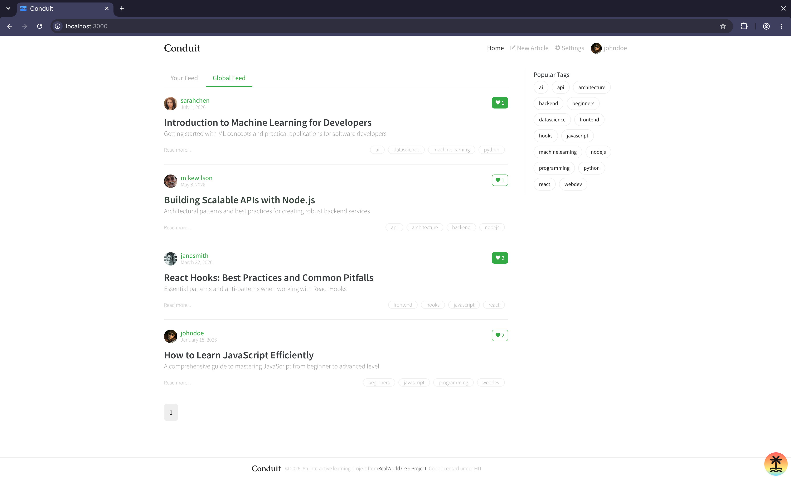

# Conduit UI

A frontend implementation of the [RealWorld](https://github.com/gothinkster/realworld) project (see the [introduction post](https://medium.com/@ericsimons/introducing-realworld-6016654d36b5)), a "Medium.com clone" called **Conduit**. It's built with React 19 and the TanStack ecosystem, and follows the shared RealWorld API spec so it can work with any compliant backend.

<!-- Add a screenshot belowss -->



## Tech Stack

**Core**

- [React 19](https://react.dev/) – UI library
- [Vite](https://vite.dev/) – dev server and build tool
- [TanStack Router](https://tanstack.com/router) – type-safe routing
- [TanStack Query](https://tanstack.com/query) – server state and data fetching
- [TanStack Form](https://tanstack.com/form) – form state and validation
- [TanStack Markdown](https://tanstack.com/) – markdown rendering for articles and comments
- [Zustand](https://zustand.docs.pmnd.rs/) – client state management
- [Zod](https://zod.dev/) – schema validation
- [Better Fetch](https://better-fetch.vercel.app/) – typed HTTP client
- [CASL](https://casl.js.org/) – permissions and authorization

**Testing**

- [Vitest](https://vitest.dev/) with [Vitest Browser Mode](https://vitest.dev/guide/browser/) and [vitest-browser-react](https://github.com/vitest-dev/vitest-browser-react) – unit and component tests
- [Playwright](https://playwright.dev/) – end-to-end tests
- [MSW](https://mswjs.io/) – API mocking
- [factory.ts](https://github.com/willryan/factory.ts) – test data factories

**Tooling**

- [Oxlint](https://oxc.rs/docs/guide/usage/linter) – linting
- [Oxfmt](https://oxc.rs/) – formatting
- [Knip](https://knip.dev/) – unused code and dependency detection
- [Lefthook](https://lefthook.dev/) – git hooks
- [pnpm](https://pnpm.io/) – package manager

## Getting Started

### Prerequisites

- [Node.js](https://nodejs.org/)
- [pnpm](https://pnpm.io/installation)

### Installation

Clone the repository and run the initialize script:

```bash
git clone https://github.com/michael-wolfenden/conduit-ui
cd conduit-ui
pnpm initialize
```

`pnpm initialize` pulls the RealWorld git submodule, installs dependencies, and sets up the git hooks.

### Running the app

```bash
pnpm dev
```

The app will be available at [http://localhost:3000](http://localhost:3000).

### Logging in

When running against the mocked API (MSW), you can log in with any of the seeded users defined in [`src/__msw__/db.ts`](./src/__msw__/db.ts):

| Email                     | Password      |
| ------------------------- | ------------- |
| `john.doe@example.com`    | `password123` |
| `jane.smith@example.com`  | `password123` |
| `mike.wilson@example.com` | `password123` |
| `sarah.chen@example.com`  | `password123` |

## Available Scripts

| Command                  | Description                                                                                               |
| ------------------------ | --------------------------------------------------------------------------------------------------------- |
| `pnpm initialize`        | Refreshes the RealWorld submodule, installs dependencies, and installs git hooks. Run this after cloning. |
| `pnpm dev`               | Starts the Vite dev server on port 3000.                                                                  |
| `pnpm build`             | Creates a production build.                                                                               |
| `pnpm preview`           | Serves the production build locally.                                                                      |
| `pnpm lint`              | Runs Oxlint.                                                                                              |
| `pnpm format`            | Formats the codebase with Oxfmt.                                                                          |
| `pnpm check`             | Runs all checks in parallel (format, Oxlint, Knip) and prints a summary table.                            |
| `pnpm check:format`      | Checks formatting without making changes.                                                                 |
| `pnpm check:oxlint`      | Runs Oxlint.                                                                                              |
| `pnpm check:knip`        | Finds unused files, exports, and dependencies.                                                            |
| `pnpm test`              | Runs the Vitest test suite once.                                                                          |
| `pnpm test:ui`           | Opens the Vitest UI.                                                                                      |
| `pnpm test:e2e`          | Runs Playwright end-to-end tests with mocks disabled.                                                     |
| `pnpm test:e2e:ui`       | Runs Playwright end-to-end tests in UI mode.                                                              |
| `pnpm refresh-submodule` | Resets and re-pulls the RealWorld submodule from its remote.                                              |
| `pnpm update-deps`       | Interactively upgrades dependencies to their latest versions, then dedupes.                               |
| `pnpm prepare`           | Installs Lefthook git hooks (runs automatically on install).                                              |

## Project Structure

```
.
├── public/        # Static assets (including the MSW service worker)
├── realworld/     # RealWorld spec (git submodule)
├── src/           # Application source
└── ...
```

Path aliases are configured so you can import with:

- `#app/*` → `./src/*`
- `#realworld-submodule/*` → `./realworld/*`

## Testing

- **Unit / component tests** run with Vitest in browser mode: `pnpm test`
- **End-to-end tests** run with Playwright against a real backend (mocks are turned off via `VITE_ENABLE_MOCKS=false`): `pnpm test:e2e`

API mocking is handled by MSW, which is useful for developing and testing without a running backend.

## Known Issues

### Playwright E2E Tests

Some of the Playwright end-to-end tests (which come from the shared RealWorld spec in the `realworld` submodule) currently fail because of bugs in the specs themselves, not in this app:

- [realworld-apps/realworld#1724](https://github.com/realworld-apps/realworld/issues/1724): the "should view article from home feed" test is flaky. It uses `waitForURL`, which can resolve before the article page has rendered, so later assertions may run against the stale home page.
- [realworld-apps/realworld#1725](https://github.com/realworld-apps/realworld/issues/1725): the "should delete comment when server returns 200 instead of 204" test mocks the `DELETE` response without forwarding it to the backend. The comment is never deleted on the server, so a correct frontend that refetches comments after deleting will still show it and the test fails.

These should be resolved once the upstream issues are fixed and the submodule is updated (`pnpm refresh-submodule`).

### Playwright Browsers

I'm on Arch Linux, where playwright install chromium doesn't work. Arch isn't an officially supported Playwright platform, so the downloaded browser builds aren't available or don't run correctly.

As a workaround, the Vitest browser provider is pointed at the system Chromium binary instead:

```typescript
provider: playwright({
  launchOptions: {
    executablePath: "/usr/bin/chromium",
  },
}),
```

The Playwright UI mode is also run with a fixed UI port `--ui-port=0`, which serves UI mode over HTTP on a random free port, so it also uses my local Chromium.

```bash
pnpm test:e2e --ui --ui-port=0
```

**On other platforms** (macOS, Windows, or a supported Linux distro) you should probably remove the `executablePath` override and install the Playwright browsers instead:

```bash
pnpm exec playwright install [browser]
```

## License

This project is licensed under the MIT License.
